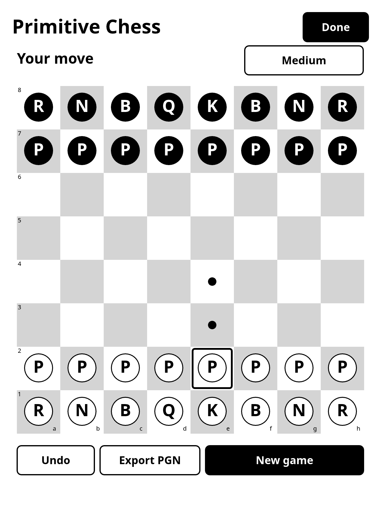
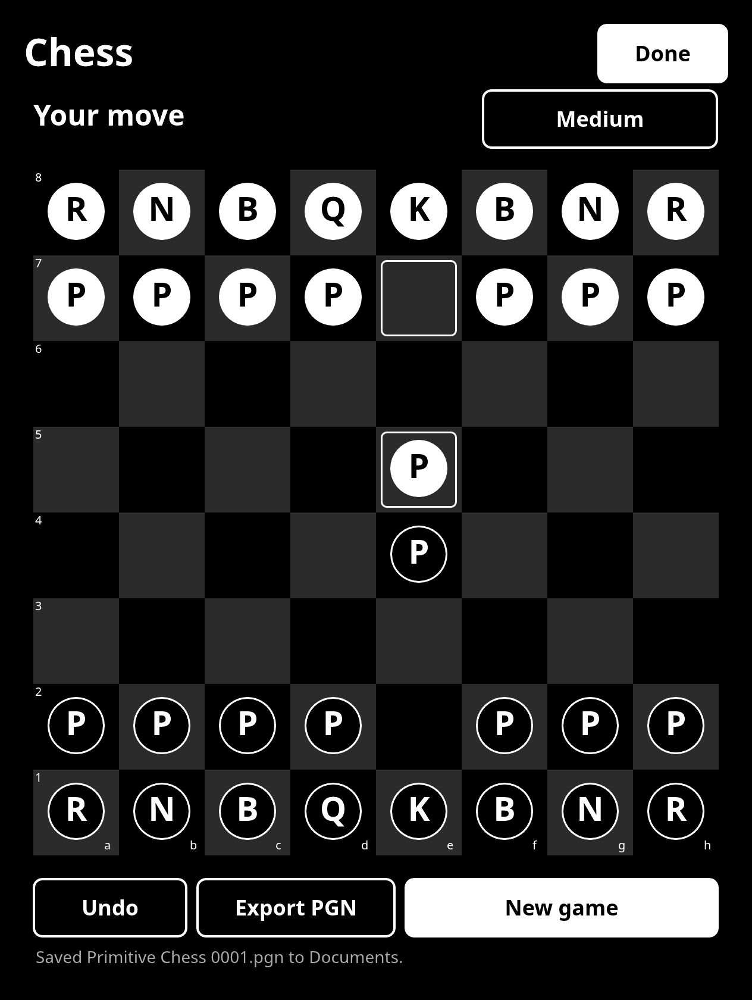

<div align="center">

# Chess

**Play chess against your Kindle**

[](https://github.com/PrimitiveOS/kindle-primitive-chess/actions/workflows/ci.yml)
[](https://github.com/PrimitiveOS/kindle-primitive-chess/releases)
[](https://github.com/PrimitiveOS/kindle-primitive-chess/tags)
[](LICENSE)
[](https://github.com/PrimitiveOS/kindle-primitive-chess/stargazers)
[](https://primitiveos.github.io/kindle-primitive-catalog/v1/index.json)

[**Download**](https://github.com/PrimitiveOS/kindle-primitive-chess/releases/latest) · [**Install guide**](INSTALL.md) · [**Changelog**](CHANGELOG.md)

</div>

---

Play standard chess at three levels, save a game and export PGN.

## Quick start

After setting up PrimitiveOS, open **Store** from Primitive Launcher. Choose **Chess** under **Apps**,
tap **Get**, and open it from the Launcher grid. The [install guide](INSTALL.md) also covers the standalone USB package.

## Screenshots

<table>
  <tr>
    <td align="center"><br><sub>Legal moves for the selected pawn</sub></td>
    <td align="center"><br><sub>Game position and PGN export in dark mode</sub></td>
  </tr>
</table>

<sub>Screenshots from the desktop simulator at 1264 × 1680, using a sample game.</sub>

## Highlights

- **Three opponent levels.** Choose Easy, Medium, or Hard.
- **Undo and resume.** Undo the previous turn or reopen a saved game.
- **PGN export.** Save the game to the Kindle's `documents/` folder.

## Develop locally

Keep the Primitive Tools and Launcher repositories beside this checkout. The desktop command writes PNG
previews and a sample PGN to `build/previews`.

```sh
cargo test --offline --locked --workspace
cargo run --offline --locked -p chess-desktop
```

## Status

| Device | Status |
|---|---|
| Kindle Oasis 3 (1264 × 1680, firmware 5.18.2) | Tested on hardware |

**Current version: 0.1.1.** Changes are in [CHANGELOG.md](CHANGELOG.md).

## Downloads

The badge at the top shows the number of Store downloads. It counts GitHub downloads of this app's release packages, across all versions and architectures, and is refreshed daily from the [Store catalog](https://primitiveos.github.io/kindle-primitive-catalog/v1/index.json).

## Documentation

[Install guide](INSTALL.md) · [Changelog](CHANGELOG.md) · [Device notes](docs/device-notes.md)

## Licence

Copyright (C) 2026 Doan Nguyen.

- Original code is under the [PolyForm Noncommercial License 1.0.0](LICENSE).
- Original documentation and pictures, including these screenshots, are under [CC BY-NC-SA 4.0](LICENSE-DOCS).
- Standard chess move generation and notation use the MIT-licensed [cozy-chess](https://github.com/analog-hors/cozy-chess).
- The Noto Sans fonts supplied by Primitive Launcher retain their SIL Open Font License.
